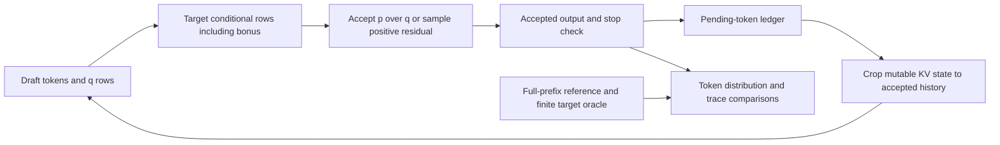

# Speculative Decoding

[](https://github.com/pavan139/speculative-decoding/actions/workflows/ci.yml) 

Exact speculative decoding with KV-cache rollback, checked against target distributions that can be enumerated exactly. The cached block engine runs local GPT-2 and Llama checkpoints through Hugging Face Transformers. The only timing recorded so far is on tiny random CPU checkpoints, not trained models.

A draft model proposes tokens from q. The target model supplies p. For a proposed token x, the sampler accepts with probability `min(1, p(x)/q(x))`; after rejection it samples from normalized `max(p-q, 0)`. If a whole block is accepted, it draws one extra target token.

That correction matters: accepting every plausible draft token changes the output law. This repository keeps a slow full-prefix implementation, an independently enumerated finite target law, and a cached block engine so the probability and cache rules can be checked separately.

## Start with a distribution you can enumerate

```bash
python -m pip install -e .
python -m speculative_decoding evaluate --samples 3000 --output artifacts/marginals.json
python -m speculative_decoding joint --samples 6000 --horizon 4 --draft-tokens 3 --stop-token 1 --output artifacts/stopped-joint.json
```

Python 3.11+ is sufficient for these experiments. The first command checks twelve categorical cases and one history-dependent joint case. `joint` enumerates every positive-probability path for a bounded target horizon, including variable-length stop leaves, then compares samples path by path. It reports target mass, counts, total variation, illegal outputs, and a simultaneous Hoeffding reference band. Finite-sample agreement is evidence, not a proof for arbitrary models. Enumeration is limited to eight output tokens and an explicit leaf budget.

## Three inference paths

| Engine | Target work | Purpose |
| --- | --- | --- |
| Serial | full prefix, no KV reuse | straightforward probability reference |
| Cached serial | cached next-token forwards | separate cache reuse from block verification |
| Cached block | one target forward for the draft block and bonus row | test actual speculative verification |



The cached implementation supports unpadded batch-one GPT-2 and standard-RoPE Llama with DynamicCache, eager attention, and unquantized weights. It retains only the required final `k+1` logit rows. A rejected branch crops both cache state and its token ledger; a forward failure resets them before reuse. Sliding/static caches, nonstandard RoPE, quantization, and multi-request batching are outside this implementation.

## What the CPU measurement says

The [stored random-checkpoint run](results/cpu-tiny-benchmark.json) used a 31,616-parameter target, a 6,384-parameter draft, CPU float32, and one torch thread:

| Mode | Median generation time |
| --- | ---: |
| Full-prefix serial | 292.9 ms |
| Cached serial | 204.3 ms |
| Cached block | 109.8 ms |

Each measured request started with empty caches and included prefill; loading and warmups were excluded. The checkpoints were generated locally and deleted after the run. This is one fixed-order CPU fixture measurement, not a trained-model or GPU speedup result. [The measurement record](research/cached-block-results.md) retains physical forward/input-token counters, stopping differences, and all setup details.

To repeat that fixture after installing `.[hf]`, run `python bench/time_random_checkpoints.py --output artifacts/tiny-cpu.json`. To use existing local weights:

```bash
python -m pip install -e '.[hf]'
python -m speculative_decoding hf-benchmark --target /path/to/local/target --draft /path/to/local/draft --prompt 'A small experiment:' --warmups 2 --repeats 5 --threads 1 --output artifacts/benchmark.json
```

Token-to-ID mappings, special tokens, vocabulary support, and context limits must agree. The loader does not download checkpoints or enable remote code. More accepted tokens do not necessarily mean less total token work; inspect physical forwards, cache crops, and input-token counts alongside elapsed time.

## Navigation

```text
src/speculative_decoding/sampling.py   serial acceptance and residual law
src/speculative_decoding/block.py      block verification contract
src/speculative_decoding/hf.py         local HF and cache ledger
checks/                               finite laws and tiny-model regressions
bench/                                timing and targeted mutation tools
experiments/categorical_plan.json     documented fixture settings
research/probability-and-cache.md     derivation and cache invariants
```

Run `RUN_ML_SMOKE=1 PYTHONPATH=src python -m unittest discover -s checks -v` with the HF extra to include local random GPT-2/Llama tests. Without the extra, optional tests skip explicitly. `python bench/check_sampling.py --require-lint --wheel` also checks the installed wheel. See [the correctness notebook](research/correctness-notebook.md), [measurement protocol](research/measurement-protocol.md), and [check record](research/checks-run.md). Historical mutation traces retain the paths used when they were recorded.
