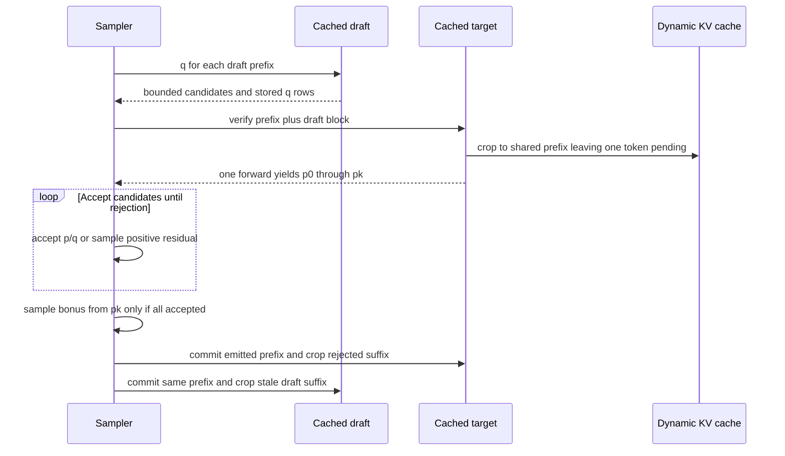

# Draft verification and target-law checks

The trusted boundary is the sampler: backend probability vectors are validated for finite nonnegative entries, normalization, and vocabulary length. The caller controls a bounded token prefix, seed, output budget (at most 4096), and draft window (at most 64). The explicit context budget prevents silent context truncation. The algorithm never executes model text, makes network calls, or calls application tools.

For proposal x drawn from q, accept with probability min(1,p(x)/q(x)). Rejection samples from normalized max(p-q,0). On all-accepted blocks, draw one further token from the target, unless the output budget or stop token ends generation. These operations preserve the target distribution under exact backend probabilities. Floating point probabilities are checked and normalized within tolerance.

The serial HF adapter retains full-prefix recomputation with `use_cache=False`. The cached target verifies a whole draft block plus bonus conditional in one physical forward; the cached draft consumes only its pending suffix. Local-only loading, disabled remote code, and inference mode apply to both. Model compute can still exceed host resources; the caller chooses checkpoints and device explicitly. There is no synthetic fallback. Missing dependencies, incompatible tokenizers, invalid distributions, and context errors fail visibly.

Evaluation covers categorical marginals and a two-token conditional joint distribution. Runtime/quality conclusions about any particular trained model require a separately executed model experiment. Unit tests are offline and never download weights.

The `exact_joint_distribution` oracle separately expands the target output tree by multiplying conditionals; it has no draft backend, acceptance/rejection logic, or random generator. The `joint` benchmark compares all enumerated paths with sampled trajectories, including variable-length stop leaves. The oracle's leaf budget prevents exponential allocation. Sampling never changes Python's global RNG state, and Markov parameters are copied into normalized tuples so external list mutation cannot alter an existing fixture.

The optional HF boundary validates tokenizer IDs against model vocabulary, keeps BOS in the persistent prefix, checks direct prefix IDs, and honors the smaller of explicit and checkpoint context budgets. Tiny random local checkpoint tests verify these mechanics without downloads or model-quality claims.

`CachedHFModel` supports batch-one unpadded GPT-2 and standard-RoPE Llama with DynamicCache. It leaves the final committed token pending and uses explicit cache positions/masks. Commit is a KV crop, not another model forward. A failure after in-place DynamicCache mutation resets both physical cache and token ledger. Unsupported cache/model variants are not silently approximated. [probability-and-cache.md](probability-and-cache.md) derives conditional indices, rollback, complexity, and the supported scope.

The benchmark shares weights across full-prefix, cached-serial, and cached-block modes, excludes warmups/loading, resets caches for each request, includes prefill, and reports physical counters alongside elapsed time. [cached-block-results.md](cached-block-results.md) records actual CPU fixture evidence and its limits.
